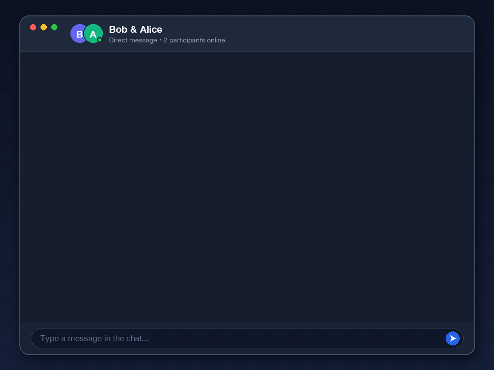

# Animated Chat GIF Generator

Generate clean, realistic animated chat GIFs from declarative JSON, TOML, or YAML configuration files.

The tool renders a modern macOS-style chat window complete with realistic window chrome, drop shadows, participant avatars, typing indicators, bubble pop-in animations, link formatting, and emoji support.



## Features

- **macOS & Mobile Aesthetics**:
  - **Dark Theme (`dark`)**: Dark-slate chat interface with traffic light controls, header avatars, online status, and bottom input field.
  - **Light Theme (`light`)**: Sleek airy light-theme card with pastel gradient backdrop, soft elevation shadow, directional tail chat bubbles, and indigo/sky accents.
  - **Landscape & Portrait Modes**: Desktop landscape window (`1024x768` default) or vertical mobile portrait layout (`576x960` default, complete with status bar, Dynamic Island, signal/battery icons, and home indicator bar).
- **Customizable Participants**: Configurable display names, avatar letters, bubble colors, border colors, and chat alignment (left/right).
- **Realistic Animation Flow**:
  - Configurable initial pause showing the idle chat window before conversation begins.
  - Realistic typing indicators (animated pulsing dots with configurable typing durations).
  - Smooth message pop-in with opacity and translation transitions.
  - Configurable hold duration per message.
- **Rich Content Support**: Automatic detection and styling of URLs/links and emoji characters.
- **High-Quality Optimized Output**: Uses FFmpeg two-pass palette generation (`palettegen` / `paletteuse`) for crisp colors and compact file size.
- **Synchronized MP3 Audio Track**: Automatically generates a companion `.mp3` audio file with spatial stereo message pop-up sounds (`received` warm bubble chime for incoming left-side messages, `sent` crisp upward pop for outgoing right-side messages, plus `pop`, `chime`, `ding`, or custom sound files) timed to each message's appearance on screen.
- **Optional Compact MP4 Video (`-v` / `--video`)**: Optionally generates a self-contained `.mp4` video with the animation and synchronized stereo audio (`libx264 -tune animation` + AAC, typically smaller than the GIF alone).
- **Single-Play or Loop Options**: Configured by default to play once without looping (`-loop -1`), or customizable to loop infinitely or a specified number of times.

## Dependencies & Prerequisites

### System Requirements

- **Operating System**: macOS (the script uses macOS system fonts: `/System/Library/Fonts/HelveticaNeue.ttc` and `/System/Library/Fonts/Apple Color Emoji.ttc`).
- **FFmpeg**: Required for compiling frames into an optimized GIF and encoding the MP3 audio track.
  ```bash
  brew install ffmpeg
  ```

### Python Dependencies

- **Python 3.10+**
- **Pillow**: Python imaging library for frame rendering.
  ```bash
  pip install Pillow
  ```
- **PyYAML** (Optional): Only needed if you prefer YAML configuration files over JSON or TOML.
  ```bash
  pip install pyyaml
  ```

## Usage

### Quick Start

Generate a timestamped `chat-<HHMMSS>.gif` and its synchronized `chat-<HHMMSS>.mp3` audio track using the default configuration file (`chat-config.json`):

```bash
python3 generate_chat_gif.py
```

### CLI Arguments

```bash
python3 generate_chat_gif.py [config_file] [-o OUTPUT] [-a AUDIO_OUTPUT] [--no-audio] [-v [VIDEO_OUTPUT]] [--no-video] [-t {dark,light}] [-p | --landscape] [--loop LOOP] [--initial-delay INITIAL_DELAY]
```

- `config_file` *(optional)*: Path to the configuration file (defaults to `chat-config.json`). Supports `.json`, `.toml`, and `.yaml` / `.yml`.
- `-o`, `--output` *(optional)*: Override the output GIF file path. When omitted, a short `HHMMSS` timestamp is appended to the configured output filename (e.g., `chat-093409.gif`).
- `-a`, `--audio-output` *(optional)*: Override the output MP3 file path (defaults to matching the output GIF filename with an `.mp3` extension).
- `--no-audio` *(optional)*: Disable generating the companion MP3 file.
- `-v`, `--video [VIDEO_OUTPUT]` *(optional)*: Also generate a compact `.mp4` video with synchronized audio. If no path is provided, defaults to matching the output GIF filename with an `.mp4` extension.
- `--no-video` *(optional)*: Disable MP4 video generation if enabled in the configuration file.
- `-t`, `--theme` *(optional)*: Visual look and feel: `dark` (default) or `light`.
- `-p`, `--portrait` *(optional)*: Render in vertical mobile portrait mode (`576x960` default).
- `--landscape` *(optional)*: Render in desktop landscape mode (`1024x768` default).
- `--loop` *(optional)*: Number of loops (`-1` to play once, `0` for infinite loop, or a positive integer for a specific repetition count; default: `-1`).
- `--initial-delay` *(optional)*: Delay in seconds to display the empty window before the first message begins (default: `2.0`).

### Examples

```bash
# Light look and feel
python3 generate_chat_gif.py --theme light -o chat-light.gif

# Portrait mode (vertical mobile layout)
python3 generate_chat_gif.py --portrait -o chat-portrait.gif

# Generate GIF, MP3, and a compact MP4 video with synced audio
python3 generate_chat_gif.py -v
```

## Configuration Reference

A sample `chat-config.json`:

```json
{
  "output": "chat.gif",
  "audio_output": "chat.mp3",
  "theme": "dark",
  "portrait": false,
  "width": 1024,
  "height": 768,
  "fps": 20,
  "loop": -1,
  "initial_delay": 2.0,
  "audio": {
    "enabled": true,
    "volume": 0.85,
    "left_sound": "received",
    "right_sound": "sent",
    "typing_sound": false
  },
  "window": {
    "title": "Bob & Alice",
    "subtitle": "Direct message • 2 participants online",
    "input_placeholder": "Type a message in the chat...",
    "typing_status_template": "{sender} is typing...",
    "typing_bubble_label_template": "{sender} is typing..."
  },
  "participants": {
    "Bob": {
      "side": "left",
      "avatar_letter": "B",
      "avatar_color": "#6366f1",
      "name_color": "#a5b4fc",
      "bubble_color": "#26344a",
      "bubble_border_color": "#3b4c69",
      "text_color": "#f8fafc"
    },
    "Alice": {
      "side": "right",
      "avatar_letter": "A",
      "avatar_color": "#10b981",
      "name_color": "#6ee7b7",
      "bubble_color": "#2563eb",
      "bubble_border_color": "#3b82f6",
      "text_color": "#ffffff"
    }
  },
  "messages": [
    {
      "sender": "Bob",
      "time": "17:24",
      "text": "Honestly, I don't get why we still keep expensive devs around when AI just coded everything for me in 20 minutes without a single bug! Your job is dead 💀",
      "typing_duration": 0.0,
      "hold_duration": 4.25
    },
    {
      "sender": "Alice",
      "time": "17:25",
      "text": "Oh really? Awesome, send me the link so I can test it!",
      "typing_duration": 2.5,
      "hold_duration": 1.9
    }
  ]
}
```

### Configuration Keys

| Parameter | Type | Description |
|---|---|---|
| `output` | string | Base output file path for the generated GIF (a short timestamp is added unless `-o` is used). |
| `audio_output` | string | Base output file path for the companion MP3 audio file (defaults to `<output>.mp3`). |
| `video` / `video_output` | boolean / string | Optional MP4 video output with synchronized audio (e.g., `true` or `"chat.mp4"`). |
| `theme` | string | Look and feel preset: `"dark"` (default) or `"light"`. |
| `portrait` | boolean | Enable vertical mobile portrait layout (`576x960` default). Also supports `"orientation": "portrait"`. |
| `width` | integer | Canvas width in pixels (e.g., `1024` for landscape, `576` for portrait). |
| `height` | integer | Canvas height in pixels (e.g., `768` for landscape, `960` for portrait). |
| `fps` | integer | Frame rate in frames per second (e.g., `20`). |
| `loop` | integer / bool | GIF loop count (`-1` = play once, `0` = infinite). Default is `-1`. |
| `initial_delay`| float | Duration in seconds before the conversation starts. Default is `2.0`. |
| `audio` | object | Audio settings (`enabled`, `volume`, `left_sound`, `right_sound`, `typing_sound`). Built-in sounds: `received`, `sent`, `pop`, `chime`, `ding`, `none`, or a path to an audio file. |
| `window` | object | Customization for the window title, subtitle, placeholders, and templates. |
| `participants` | object | Participant styling dictionary keyed by sender name (`avatar_letter`, `avatar_color`, `bubble_color`, `side`, optional `sound`, etc.). |
| `messages` | array | Ordered list of messages with `sender`, `time`, `text`, `typing_duration`, `hold_duration`, and optional `sound` / `volume`. |

## Sample Conversations

The [`samples/`](samples/) directory includes 10 ready-to-use conversations showcasing different themes (`dark` / `light`), orientations (`landscape` / `portrait`), sound presets, and typing effects—each with its configuration (`.json`), animated GIF (`.gif`), audio track (`.mp3`), and compact video (`.mp4`):

| Sample | Participants | Mode & Theme | Outputs |
|---|---|---|---|
| `01-friday-deploy` | Dev & Ops | Landscape • Dark | [Config](samples/01-friday-deploy.json) • [GIF](samples/01-friday-deploy.gif) • [MP3](samples/01-friday-deploy.mp3) • [MP4](samples/01-friday-deploy.mp4) |
| `02-rubber-duck` | Maya & Rubber Duck 🦆 | Portrait • Light | [Config](samples/02-rubber-duck.json) • [GIF](samples/02-rubber-duck.gif) • [MP3](samples/02-rubber-duck.mp3) • [MP4](samples/02-rubber-duck.mp4) |
| `03-first-open-source-pr` | Maintainer & Sam | Landscape • Light | [Config](samples/03-first-open-source-pr.json) • [GIF](samples/03-first-open-source-pr.gif) • [MP3](samples/03-first-open-source-pr.mp3) • [MP4](samples/03-first-open-source-pr.mp4) |
| `04-mars-rover-checkin` | Houston & Perseverance | Portrait • Dark | [Config](samples/04-mars-rover-checkin.json) • [GIF](samples/04-mars-rover-checkin.gif) • [MP3](samples/04-mars-rover-checkin.mp3) • [MP4](samples/04-mars-rover-checkin.mp4) |
| `05-coffee-overflow` | BaristaOS & Alex | Landscape • Dark | [Config](samples/05-coffee-overflow.json) • [GIF](samples/05-coffee-overflow.gif) • [MP3](samples/05-coffee-overflow.mp3) • [MP4](samples/05-coffee-overflow.mp4) |
| `06-lovelace-turing` | Ada Lovelace & Alan Turing | Landscape • Light | [Config](samples/06-lovelace-turing.json) • [GIF](samples/06-lovelace-turing.gif) • [MP3](samples/06-lovelace-turing.mp3) • [MP4](samples/06-lovelace-turing.mp4) |
| `07-newton-einstein` | Isaac Newton & Albert Einstein | Portrait • Dark | [Config](samples/07-newton-einstein.json) • [GIF](samples/07-newton-einstein.gif) • [MP3](samples/07-newton-einstein.mp3) • [MP4](samples/07-newton-einstein.mp4) |
| `08-curie-franklin` | Marie Curie & Rosalind Franklin | Landscape • Dark | [Config](samples/08-curie-franklin.json) • [GIF](samples/08-curie-franklin.gif) • [MP3](samples/08-curie-franklin.mp3) • [MP4](samples/08-curie-franklin.mp4) |
| `09-davinci-michelangelo` | Leonardo da Vinci & Michelangelo | Portrait • Light | [Config](samples/09-davinci-michelangelo.json) • [GIF](samples/09-davinci-michelangelo.gif) • [MP3](samples/09-davinci-michelangelo.mp3) • [MP4](samples/09-davinci-michelangelo.mp4) |
| `10-hopper-hamilton` | Grace Hopper & Margaret Hamilton | Landscape • Light | [Config](samples/10-hopper-hamilton.json) • [GIF](samples/10-hopper-hamilton.gif) • [MP3](samples/10-hopper-hamilton.mp3) • [MP4](samples/10-hopper-hamilton.mp4) |

## License

This project is licensed under the Apache License, Version 2.0. See [LICENSE](LICENSE) for details.

## Disclaimer

This is not an officially supported Google product.

